
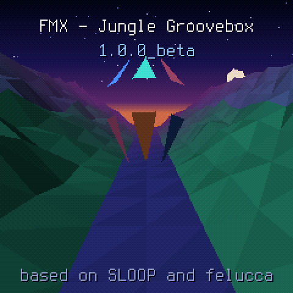

# FMX User Manual

**Jungle / breakcore groovebox firmware for the M-VAVE FM-1** · firmware 1.0.0_beta · also as a [PDF](docs/FMX-Manual.pdf)

FMX is free software under GPL-3.0, with no warranty. It is based on SLOOP by isod89 and Felucca by Leo Kuroshita (Hügelton Instruments); the BREAK generator follows X0X by charlesvestal. M-VAVE and FM-1 are trademarks of their owners; FMX is not affiliated with or endorsed by them. Screens in this manual are rendered from the firmware's own drawing code. Manual written October 2026.

<!-- Made from docs/manual/manual.html: edit that file, then regenerate this one. -->

## Contents

1. Welcome to FMX
2. Install, update, go back
3. The controls at a glance
4. Five rules that hold on every screen
5. Your first minute
6. LIVE: playing a set
7. Moving between songs
8. The FX panel
9. STUDIO and the DECK
10. BREAK
11. BASS
12. CHORDS
13. CHOP
14. Recording and the step layers
15. Sound pages (ENV, FX, SEL, GLO…)
16. Songs: SET, CHAIN, CARD, TRACKS
17. The companion app
18. The system menu
19. Troubleshooting
20. Glossary and abbreviations

## 1 · Welcome to FMX

FMX turns the FM-1 into a four-track jungle and breakcore machine you can plug into a PA and play a whole set on. Each track has its own generator, so the music writes itself while your hands shape it: you pick sections, mute and bring in tracks, throw effects, and move from song to song without stopping.

- **BREAK**: Chopped break loops, re-sequenced live by a generator (styles from STRAIGHT to CHAOS).
- **BASS**: Reese and sub basses playing a two-bar call-and-answer phrase.
- **CHORDS**: Pads, keys and organs over a generated chord progression.
- **CHOP**: Three modes: a kit of 16 pads, a sliced loop, or a lead playing a theme.

The firmware has two modes:

- **LIVE** is for performing. One fixed control map, whatever track you are on. FMX boots into LIVE.
- **STUDIO** is for building songs: each track's own screen, its sound pages, recording, and the song's section cards.

A song is up to four **songs** in a **set**. Each song is built from one loop and played as a full arrangement: INTRO, BUILD, DROP, ROLL, BREAKDOWN, DROP 2, OUTRO.

> **Beta.** FMX 1.0.0 is a beta. Back up your set from the companion app before you update, and report what you find.

## 2 · Install, update, go back

Everything off the device happens in the **FMX Companion**, a web app. Connecting the FM-1 needs Web MIDI: Chrome, Edge or Firefox on a computer, or Chrome on Android. On Safari and iPhone the emulator and your sound library still work, but you cannot connect the FM-1.

### Install or update FMX

1. Connect the FM-1 to the computer with a USB cable and open the companion app.
2. In **Firmware**, the app shows what is on your FM-1 and what it has. Press **Install FMX**.
3. The app checks the package, sends it, and the FM-1 restarts and reports back. **Keep the FM-1 on USB until it restarts.**

Your songs and sounds stay on the FM-1 through updates.

### Back to the stock firmware

1. Back up your set first (**Sounds on the FM-1 → Back up the set**). The stock firmware cannot open FMX's songs or sounds.
2. Download FM-1 V15 from m-vave.com (Downloads → PC Firmware → FM-1 V15).
3. In **Back to stock**, tick *I backed up my set*, choose the `FM-1.fwsc` file and press **Install stock V15**. The app checks the file really is V15 before it sends anything.

To come back, install FMX again and restore your set.

### If it won't start

Hold `OCT−` while you switch the FM-1 on. It starts in **USB rescue**, and you can install again from the companion app.

## 3 · The controls at a glance

| Control | What it is |
| --- | --- |
| 16 white keys | The main keys. Their job depends on the screen: sections and moves in LIVE, steps or notes in STUDIO, effects in the FX panel. |
| Black keys | "The hands": they play the track in focus (break slices, bass notes, chords, chop hits; in LIVE, CHOP's black 1–3 pick its mode) or pick tracks in the FX panel. |
| KNOB 1–4 | Always the four values drawn at the bottom of the screen. |
| SELECT | Tempo in LIVE; turns the pages of a screen in STUDIO. |
| ALGORITHM | Picks the track in focus (in SONG: the section). |
| PRESETS | The focus track's sound (on the BREAK: its loop A). |
| MASTER | Output level, after the limiter. |
| HOME | Tap: up to the top of the mode, then LIVE ↔ STUDIO. Hold: the system menu. |
| PLAY | Start / stop. Works on every screen, even in the menu. In LIVE it plays the song; in STUDIO, the loop you are making. |
| OCT− / OCT+ | In LIVE: pick the next song. In STUDIO: octave, and on some screens mute / next page; on CHOP they walk the mode tabs. |
| FX, ENV, LFO, SEL, EDIT, GLO, SAVE, ARP, SEQ, REC | Function buttons. Tapped, they open pages; held, many become a **layer** that changes what the keys and knobs do (see chapter 14). FX held always opens the FX panel. |

Colours are consistent everywhere: BREAK orange, BASS blue, CHORDS teal, CHOP pink. **Yellow** always means *waiting*: a choice that will happen on the next bar or phrase.

## 4 · Five rules that hold on every screen

1. **HOME is back.** One press goes deeper; HOME always brings you back one step.
2. **HOME tap** goes to the top of the mode you are in (LIVE's main screen, or STUDIO's DECK). Tap it again there to switch between LIVE and STUDIO.
3. **PLAY/STOP** works everywhere and is never blocked by a menu.
4. **The four knobs** set the four values drawn on the screen. There are no hidden assignments.
5. **HOME hold** opens the system menu (settings, ABOUT, credits). It closes back onto the screen you came from.

Every main screen has a **hint line** at the bottom that tells you what its buttons do. When in doubt, read the last line.

### Quantise (Q)

In LIVE most changes wait for a musical boundary so they always land in time. `GLO` in LIVE steps Q through **NOW**, **BAR** and **4 BARS**. While a change waits, it is shown in yellow at once, and you can keep scrolling; only your last choice is applied, once, on the boundary. `EDIT` in LIVE clears everything that is waiting.

## 5 · Your first minute

1. Switch on. FMX shows its boot screen and lands in **LIVE**. A demo set is on the device.
2. Press `PLAY`. The song starts and runs through its sections by itself (**AUTO**).
3. Turn **KNOB 1** (FILTER) left for a low-pass, right for a high-pass. Turn **KNOB 2** (ENERGY) to make the break wilder.
4. Tap white keys **9–12** to take BREAK, BASS, CHORDS or CHOP out and back in, on the bar.
5. Hold white key **13** for a GAP (the break drops out), let go to bring it back.
6. Press `OCT+` to choose the next song, then tap white key **8** to pick the way there. FMX moves to it on the next phrase.

You can try all of this before installing: the companion app's **Emulator** runs the real FMX engine in the browser, with the demo set.

## 6 · LIVE: playing a set

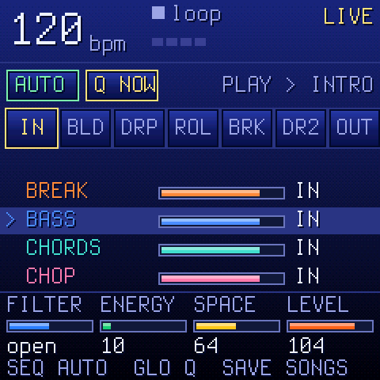 <i>LIVE. Top: AUTO, Q and the set; the section row; the tracks; the four knobs.</i>

LIVE has one screen and one control map that never changes. From the top:

- **Header**: tempo, where you are in the bar, and the section.
- **AUTO / MAN** and **Q** boxes, and the songs of the set by tempo.
- **Section row**: IN BLD DRP ROL BRK DR2 OUT. The section playing is white, the one waiting is yellow.
- **Bar counter** of the section, then the four **tracks** with their level and IN / OUT. The track in focus is marked with **>**.
- **Knobs**: FILTER, ENERGY, SPACE, LEVEL, and the hint line.

### White keys

| Key | Does |
| --- | --- |
| 1–7 | Sections: INTRO, BUILD, DROP, ROLL, BREAKDOWN, DROP 2, OUTRO. Tap to ask for one; it starts on the next phrase (Q). Stopped: a tap *arms* it (lit, silent) and PLAY starts from its first bar. |
| 8 | NEXT SONG: the way to the next song. Each tap steps BRIDGE → SWAP → CUT → none (see chapter 7). |
| 9–12 | Tracks BREAK, BASS, CHORDS, CHOP in / out, on the bar. |
| 13 (hold) | **GAP**: the BREAK drops out while held. |
| 14 (hold) | **WASH**: the mix washes into the echo and reverb. |
| 15 (hold) | **ROLL**: the break rolls. |
| 16 (hold) | **REWIND**: on release, the section restarts from its first bar. Tap a section key (1–7) while holding it and the rewind lands in that section instead, on the next bar, from its first bar. |

Moves (13–16) last only while held; let go and everything is as it was.

### Black keys

They play the track in focus (chosen with **ALGORITHM**): on the BREAK, black keys 1–4 hold loop A–D at once (whatever Q), the rest play its slices; on CHOP black keys 1–3 switch its mode at once (PADS, SLICE, INST), the rest play its kit's hits or notes; on BASS and CHORDS they play notes.

### Knobs and buttons

| KNOB 1 FILTER | The master DJ filter: left low-pass, right high-pass, centre open. |
| --- | --- |
| KNOB 2 ENERGY | The BREAK's MANGLE: how much the generator cuts, rolls and rearranges. |
| KNOB 3 SPACE | The amount of reverb. |
| KNOB 4 LEVEL | The level of the track in focus. |
| SELECT | Tempo. |
| ALGORITHM | The track in focus. |
| PRESETS | The focus track's sound (on the BREAK: loop A), applied on Q. |
| SEQ | **AUTO ↔ MAN**. AUTO: the song runs through its chain. MAN: the section loops until you choose another. Switching never changes what plays now. |
| GLO | Q: NOW, BAR, 4 BARS. |
| EDIT | Clear everything waiting (sections, the next-song way, queued mutes). |
| SEL | Open the focus track's screen in STUDIO; HOME brings you back to LIVE. |
| SAVE | Open the song SET page (load, save, new); HOME back to LIVE. |
| ENV | The show: a full-screen DRUMMER animation. Keys and knobs stay LIVE's. ENV again closes it. |
| FX (hold) | The FX panel (chapter 8). |
| OCT− / OCT+ | The next song (chapter 7). |

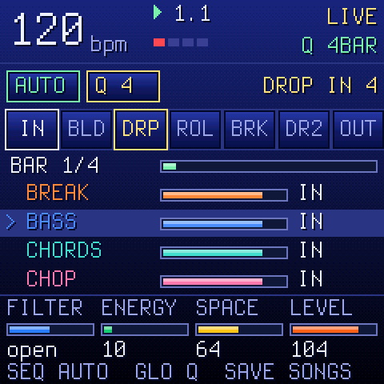 <i>DROP asked for: shown yellow, "DROP IN 4".</i>

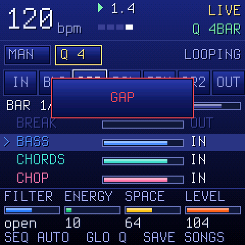 <i>MAN mode, GAP held: the BREAK is out.</i>

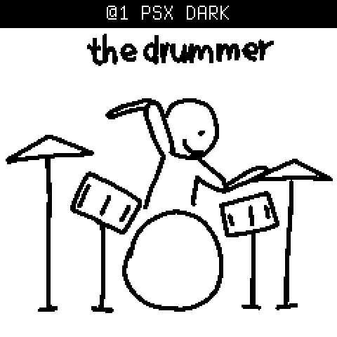 <i>ENV: the DRUMMER show.</i>

### What PLAY starts

- With a section armed, PLAY starts it from its first bar.
- With nothing armed, PLAY resumes the section where you stopped.
- A freshly loaded song has INTRO armed.
- START on the SONG screen's CHAIN page arms a section the same way (chapter 16).
- In STUDIO, PLAY plays the loop, never the song. A song still playing from LIVE stops; PLAY again starts the loop.

## 7 · Moving between songs

A set is the four song slots. Only one song is in the FM-1 at a time; the **BREAK** keeps playing across the change, so it carries every transition.

### Choosing the next song

- **Playing:** `OCT+` / `OCT−` pick the next song. The top row shows the four songs by tempo for a few seconds: the loaded one green, the next one blinking.
- **Stopped:** OCT loads that song straight away. If the song you have has unsaved edits, the screen says *NOT SAVED: AGAIN LOADS*; press the same OCT again within 2.5 s to load anyway.

### The way there (white key 8)

| Way | The old song | The new song enters at |
| --- | --- | --- |
| AUTO (end of song) | Its OUTRO becomes the bridge | BUILD |
| BRIDGE | 8 bars of bridge | BUILD |
| SWAP | Jumps to its BREAKDOWN (8 bars) | DROP |
| CUT | Stops on the phrase | DROP, tempo changes at once |

Each tap of key 8 shows the choice at once in yellow; only the last one fires, on the next 8-bar phrase. **none** or `EDIT` cancels a way that is still waiting. Once a bridge starts it plays out, and section keys, key 8 and OCT do nothing until it lands. A choice is for one change only.

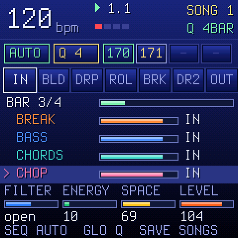 <i>The next song asked for.</i>

### During a bridge

- The BREAK plays the whole bridge, STRAIGHT, and slowly thins into a high-pass; the new song's BUILD takes it on from that point, so it reads as one DJ filter sweep.
- BASS, CHORDS and CHOP leave through the echo, not cut off.
- The tempo glides smoothly from the old song's to the new one's (except CUT).
- Before every DROP there is a short gap: two beats where the tracks go out and the echo fades to silence, so the drop hits.

### End of the set

On the last song, AUTO's OUTRO fades to silence and the transport stops; the set does not loop. Key 8 on the last song goes round to song 1 if you ask for it. In ENDLESS mode AUTO stays on the song; only key 8 moves on.

## 8 · The FX panel

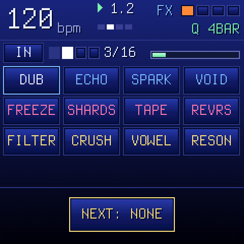 <i>The FX panel: where the music is, 12 effects, four knobs.</i>

Hold `FX` on any screen, in LIVE or STUDIO. The panel opens; let go of FX and it closes. Stuck effects keep playing after it closes.

**Lock it open:** hold FX, tap HOME, let go of FX. Tap HOME or FX (or any other button but PLAY and OCT) to close it.

The strip under the header shows the section, the four beats (the downbeat red), the bar of the section, and a gauge. In the section's last bar the count turns yellow and names the next section (e.g. *> DRP*): time a throw into the change.

| Row | Keys | Effects |
| --- | --- | --- |
| SPACE | 1–4 | **DUB VERB** (thrown into a dark, spring-like reverb) · **ECHO** throw (TIME sets the division, FEEDBACK the repeats) · **SPARKLE** (octave-up shimmer into the reverb) · **VOID** (dry out, only the reverb blooms; on release the dry returns on the next beat) |
| TIME | 5–8 | **FREEZE** (a short window held as a cloud) · **SHARDS** (the next beat cut into 1/32 shards, shuffled and pitched) · **TAPE** (wow and flutter; held past a beat it slows to a stop) · **REVERSE** (each stretch played backwards). One TIME effect at a time. |
| COLOUR | 9–12 | **DUB FILTER** (resonant low-pass closes over a beat) · **PSX CRUSH** (fewer samples and bits) · **VOWEL** (formants gliding a-e-i-o-u) · **RESONATOR** (comb tuned to the song's root) |
| RHYTHM | 13–16 | Not in this version. |

### Keys and knobs

| White 1–12 | The effect, for as long as the key is held. |
| --- | --- |
| Black 1–4 | Pick the tracks the effect goes to: BREAK, BASS, CHORDS, CHOP. Hold one or more, then press an effect. With none held, it goes to all four. The four squares in the header show the targets. |
| Black 5 LATCH | Three ways, a tap each: **OFF** (everything is held) → **TRACKS** (one padlock: tapped tracks stick) → **TRACKS + FX** (two padlocks: a tapped effect sticks, tap again to stop it). Stuck effects show a yellow outline. |
| Black 6 CLEAR | Stop every stuck effect, cut the echo and reverb tails, release stuck tracks and LATCH. |
| KNOB 1–4 | AMOUNT, TIME, TONE, FEEDBACK. |

## 9 · STUDIO and the DECK

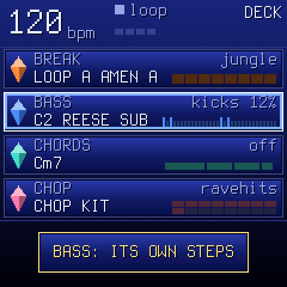 <i>The DECK: four lanes, the selected one in its colour.</i>

Tap `HOME` on LIVE's main screen to enter STUDIO. Its top level is the **DECK**: one window per track, showing what it does right now.

- **BREAK**: its style, the loop playing (A–D and name), the 8 slices with the playing one lit.
- **BASS**: the phrase's rhythm and the note and sound playing.
- **CHORDS**: the chord now and the next.
- **CHOP**: the kit or sound and its 16 pads.

A muted track greys out and says MUTE. A track armed for recording has a red frame.

| ALGORITHM | Select a track (top to bottom). |
| --- | --- |
| SEL | Open the selected track's screen. |
| PRESETS | Its sound. |
| KNOB 1–4 | Macros: FILTER (master DJ filter), MANGLE (the BREAK's), BASS (rewrites the bass phrase's MOVE), SPACE (reverb). |
| SAVE | The SONG screen (chapter 16). |
| HOME | Back to LIVE. |

On each track's screen, **HOME** (or ALGORITHM) goes back to the DECK; **SELECT** turns its pages; **PRESETS** changes its sound; **PLAY** starts and stops the loop.

## 10 · BREAK

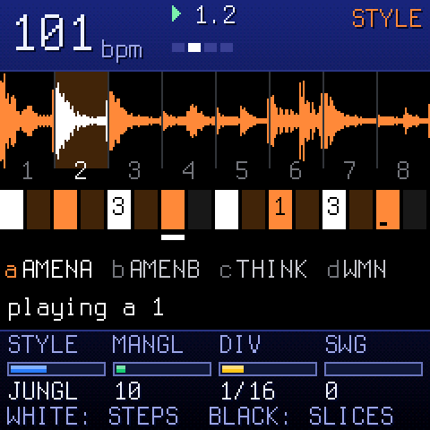 <i>The BREAK screen: the loop in 8 slices, the 16 steps, loops A–D.</i>

The BREAK plays a break loop cut into 8 slices. A generator decides, step by step, which slice plays, with rolls, stutters and fills according to its **STYLE**. You can let it run, or take steps over by hand.

Styles: **STRAIGHT, ROLLER, JUNGLE, HALFTIME, BRKCORE, CHAOS**.

Up to four loops (A–D) per song. The built-in set has 14 breaks; you can add your own from the companion app.

| White keys | The 16 steps: press to let the break play there, again to silence it. |
| --- | --- |
| Black 1–8 | Hold that slice (let go: the generator takes over). With REC on and playing, it is recorded into the step. |
| Black 9 / 10 / 11 | Reverse / half speed / stutter, while held. |
| White held + black 1–8 | Pin that slice to the step (press the same black key again to give it back to the generator). |
| White held + black 9 | The step plays backwards (again: forwards). |
| White held + KNOB 1–4 | The step's SLICE, LEVEL, RETRIG (×2–×8), PITCH. |
| PRESETS | Loop A. OCT− mutes the BREAK; OCT+ shows the next 16 steps of a longer pattern. |

### BREAK pages (tap the button)

| SEQ | STYLE: STYLE, MANGLE, DIV, SWING · again GROOVE: CMPLX, ANCHOR, ROLL, FILL |
| --- | --- |
| EDIT | LOOPS (loop A–D) → BARS → LAYER (a second break under every slice: L MIX, L PTCH) |
| ARP | RETRIG: the chance per bar of a 2×/3×/4×/8× stutter |
| SEL | PHRASE: when loops B, C, D take over |
| ENV | TUNE: pitch, length, drive, filter |
| GLO | MIX: level, pan, reverb and delay send |
| LFO | PATTERN: steps, DIV, swing, interpolation (LIN, or PSX: the PlayStation's softer sound) |

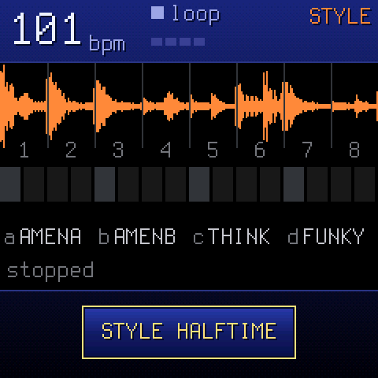 <i>STYLE page.</i>

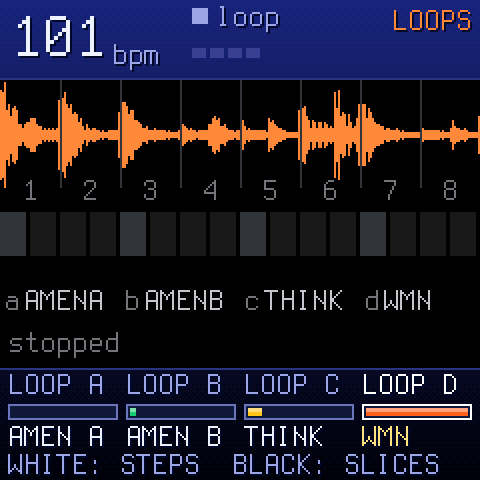 <i>LOOPS A–D.</i>

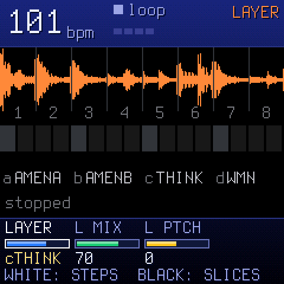 <i>LAYER: a second break under each slice.</i>

## 11 · BASS

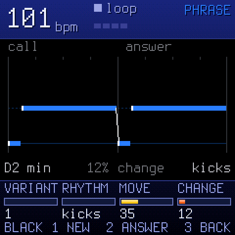 <i>BASS: bar 1 the call, bar 2 the answer.</i>

The BASS writes a two-bar phrase in the song's key: bar 1 is the **call**, bar 2 the **answer**. Notes are drawn as a roll; slides are drawn into the next note. With RHYTHM on KICKS, the bass follows the break's kicks.

Sounds (PRESETS) are reese and sub basses tuned to the jungle register (E1–D#2).

| Black 1 NEW | A new variant of the phrase. |
| --- | --- |
| Black 2 ANSWER | Another answer to the same call. |
| Black 3 BACK | The phrase as it was written, your changes since undone. |
| White keys | Play the bass. |
| SEL / SELECT | **PHRASE**: VARIANT, RHYTHM (KICKS, HALF, ROLLER, DUB, STEPPER), MOVE, CHANGE · **SHAPE**: ANSWER, HOLD, OCT, BASS FOLLOW (the bass follows the chords' roots). |

## 12 · CHORDS

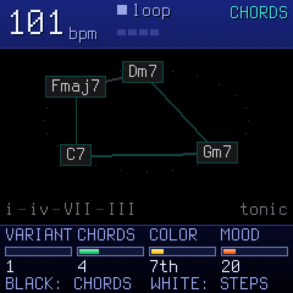 <i>CHORDS: the progression as a ring, clockwise.</i>

The progression is drawn as bubbles on a ring, in the order they play; the one playing is lit. Under it, the degrees (i – VII – III …).

Sounds are pads, keys and organs.

| Black 1–8 | The nodes (chords). Held, that chord plays over the progression. |
| --- | --- |
| Black held + KNOB 1 | Pin that chord: VARIANT changes the others. Black held + OCT− unpins it. |
| White keys | The first 16 steps of the track (PLAY = steps: each step strikes the current chord). |
| SEL / SELECT | **GEN**: VARIANT, CHORDS, COLOR, MOOD · **PLAY**: PLAY, RATE, FEEL, REG (register). |

## 13 · CHOP

The CHOP track has three modes, shown as tabs. `OCT-` / `OCT+` walk the tabs while the mode playing goes on; `SEL` plays the tab you see (no cut while you look); HOME leaves. On a tab that isn't playing you set its sound to come (KNOB 1 or PRESETS) and its own settings. SELECT shows the mode's page, STEPS or TIME. PRESETS lists only that mode's sounds.

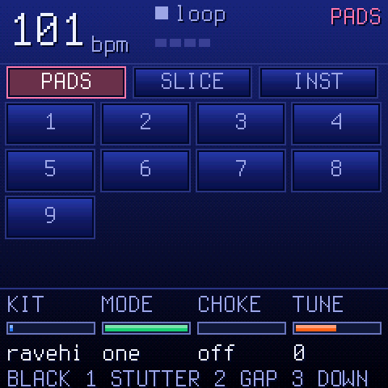 <i>PADS: a kit on 16 pads.</i>

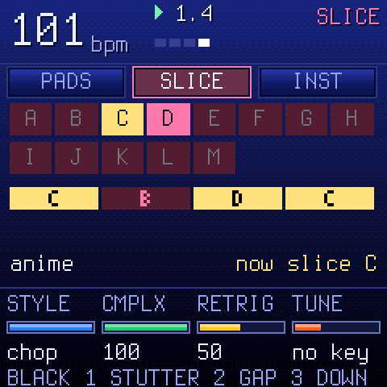 <i>SLICE: a loop following the break.</i>

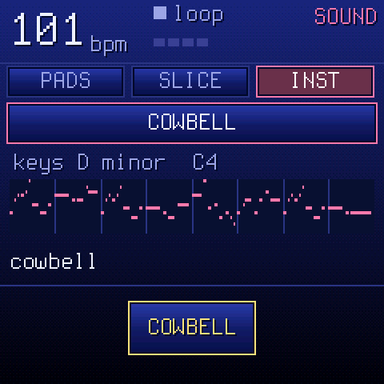 <i>INST: a lead and its theme.</i>

| Mode | Keys | Knobs |
| --- | --- | --- |
| PADS | White keys: a hit each. | KIT, MODE (ONE: hits play out · GATE: stop on release), CHOKE (a hit cuts the previous), TUNE |
| SLICE | White keys: a slice each (held: it plays on every trigger). The loop plays on the BREAK's generator and answers the break. | STYLE (STRAIGHT, HOLD, SKIP, ENDS, HALF, CHOP), CMPLX, RETRIG, TUNE (OFF, KEY, SNAP, FOLLOW) |
| INST | White keys: the song's scale from C4 (in the octave OCT set on another screen; here OCT walks the tabs). Black 4: NEW theme. | SOUND, MELODY (OFF, MIDI, ARP, SING), THEME (MIDI: which tune), CHOKE |
| STEPS | What REC recorded, 16 steps. | LENGTH (1/2/4 bars), RATE (this mode's), SWING |
| TIME | Each mode's speed on its own: the steps' grid, the SLICE loop's speed, the INST theme's. | PADS, SLICE, INST RATE (1/4, 1/8, 1/16, 1/32), OCTAVE (INST's theme, -2..+2) |

**Black keys held** in every mode: 1 STUTTER, 2 GAP, 3 DOWN. **REC** records what you play into the CHOP; holding REC clears the track.

## 14 · Recording and the step layers

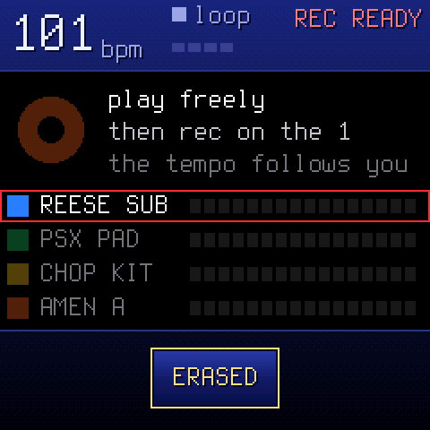 <i>REC armed: "press play, 4 clicks, then rec".</i>

`REC` arms recording on the selected track (or records at once while playing). The REC screen has three dials: **MODE** (*free*: the tempo follows your playing; *tempo*: the tempo you set), **LENGTH** (1, 2 or 4 bars) and **START** (your first note, or a one-bar count-in after PLAY).

**Hold REC** to clear the track: a ring fills; let go early and nothing is cleared. Undo brings it back.

### Layers: hold a button, touch a key

On a synth track in STUDIO, holding a function button turns the keys and knobs into a layer; the screen shows how.

| SEQ held | The 16 steps. A step held: KNOB 1–4 = note, level, ratchet, nudge; PRESETS adds a parameter lock; OCT+ sets FILL ONLY / NO FILL. |
| --- | --- |
| EDIT held | Erase a sound or a note as the loop plays. OCT− / OCT+ = undo / redo. Knobs: SHIFT, LENGTH. |
| ARP held | A key held rolls (note repeat), recorded as ratchets. KNOB 1 the rate. |
| SEL held | The key of the song: CHORD, SCALE, KEYS, TRANSPOSE. |
| GLO held | Mix: 1–4 mute, 5–8 solo, 9 fill (held), 10 fill on the next bar, 16 tap tempo; knobs the track levels. |

Hold a layer button and tap HOME to lock it open.

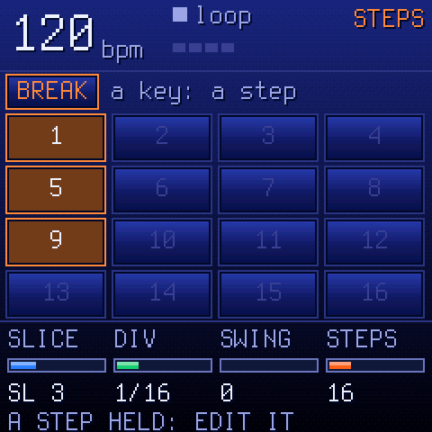 <i>SEQ held: steps.</i>

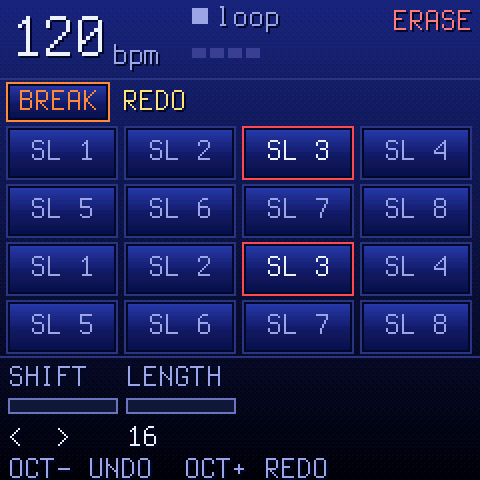 <i>EDIT held: erase.</i>

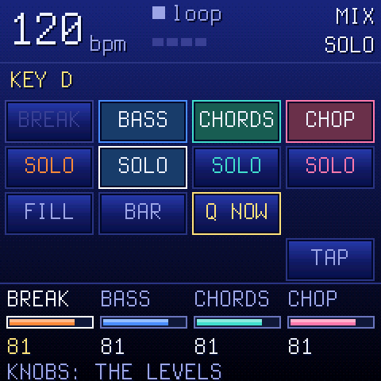 <i>GLO held: mute / solo / fill.</i>

## 15 · Sound pages

For a synth track (BASS, CHORDS, CHOP), tapping a function button opens its family of pages. Tapping it again (or SELECT) goes to the next page; HOME goes back. The page number shows in the header (e.g. *FX 1/5*).

| Button | Pages |
| --- | --- |
| ENV | ENV (attack, decay, sustain, release) · ENV DEST (filter, pitch, shape) |
| LFO | LFO (rate, wave, phase, fade) · LFO DEST (pitch, filter, shape, amp) |
| FX | FX (drive, chorus, delay, reverb sends) · FILTER (the track filter) · SLICER · DLY · REV/CHO |
| SEL | SEL (root, scale, quantise, chord) · SEL 2 (transpose, strum, voice leading) |
| EDIT | EDIT 1, EDIT 2 (the engine's own values) · VOICE · VOICE 2 · PRESETS · USER (save your own sound) · TOOLS (clear the pattern, init the sound) |
| GLO | GLOBAL (tempo, swing, click, tune) · MASTER (dust, duck, filter, the limiter's gain cut) · SYSTEM (MIDI, sync, input, USB) |

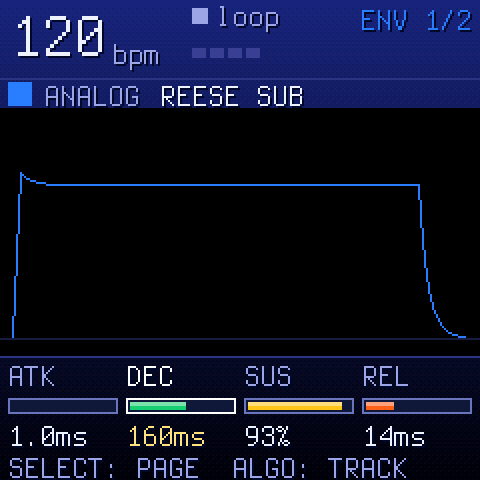 <i>ENV.</i>

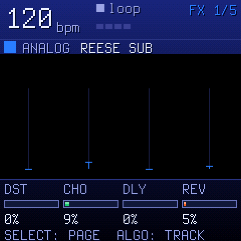 <i>FX sends.</i>

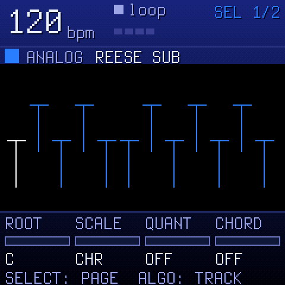 <i>SEL: key and scale.</i>

## 16 · Songs: SET, CHAIN, CARD, TRACKS

Tap `SAVE` anywhere in STUDIO (or in LIVE) to open the SONG screen on its SET page. SELECT turns the four pages; ALGORITHM picks the section shown on CHAIN, CARD and TRACKS.

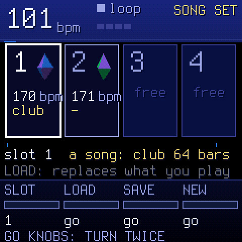 <i>SET: the four songs as memory-card blocks.</i>

### SET

The four songs of the set (slot, tempo, form; the loaded one marked).

- KNOB 1: the slot
- KNOB 2: **LOAD** · KNOB 3: **SAVE** (what you play, into the slot) · KNOB 4: **NEW** (an empty song)

LOAD, SAVE over a song, and NEW act when you turn the knob **twice**, so you can't do it by accident. Saving into an empty slot acts at once. "SAVED" confirms the write.

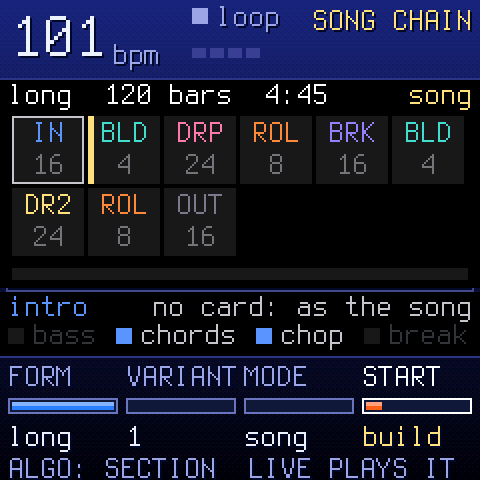 <i>CHAIN: the sections the form makes.</i>

### CHAIN

Your loop played as a whole track: a chip per section with its bars; the one playing lit. You make the song here and play it in LIVE; PLAY on this screen plays the loop.

- KNOB 1 FORM: SHORT 32, CLUB 64, LONG 128 bars
- KNOB 2 VARIANT: another song from the same loop
- KNOB 3 MODE: SONG (plays to the end) or ENDLESS
- KNOB 4 START: the section LIVE's PLAY starts from (a yellow bar on its chip). It arms it like a section key in LIVE: HOME, HOME, PLAY and you hear it.

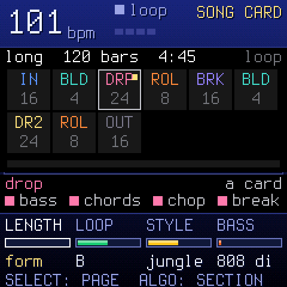 <i>CARD: how this section differs from the song.</i>

### CARD

Each section is an editable card. An empty field means "as in the song", so a new card changes nothing; a filled field stands out. A card is heard the next time its section starts; a new LENGTH from the next PLAY.

- KNOB 1 LENGTH: the form's, or 4 / 8 / 16 / 32 bars
- KNOB 2 LOOP: the break loop A–D for this section
- KNOB 3 STYLE: the break style
- KNOB 4 BASS: the bass sound

### TRACKS

KNOB 1–4 = BASS, CHORDS, CHOP, BREAK: **ON**, **OFF** or **under water** (low-passed and 12 dB down), or as the section's role says.

> The cards, FORM, VARIANT and MODE belong to the song: SAVE on the SET page keeps them.

## 17 · The companion app

One web app for everything off the device. It has three parts:

### Emulator

The real FMX engine running in your browser (works in Safari and on iPhone too). Try FMX before installing, play the demo set, or hear your sounds before you send them. Computer keys: `Z`–`'` and `Q`–`O` are the 27 keys, `1`–`=` the buttons FX…REC, `[` `]` OCT, `↑` `↓` SELECT, `←` `→` ALGORITHM. Shift-click holds a button.

### Firmware

Install, update, and go back to stock (chapter 2).

### Sounds on the FM-1

- **One sample pool** for everything: breaks, slice loops, kits and instruments. 80 blocks of 4 KB (320 KB). The map shows what is on the FM-1 now, by type.
- **Add sounds:** drop WAV files. The app tells a BREAK from a LOOP, a KIT hit or an INSTRUMENT; change it if it's wrong. Hits go onto a kit's 16 pads. For a LOOP you can move its slice lines by hand.
- **Quality:** 22, 16 or 11 kHz per sound. Lower quality fits more seconds. The app shows the free room in seconds.
- **Read back:** sounds sent from another computer show yellow ("only on the FM-1"); read them back to keep a copy.
- **Set:** back up the whole set to a file, and restore it.
- **Sound packs:** install ready-made packs in one go.

Keep the FM-1 connected while the app writes; the device shows "POOL n: ADDED" when a sound lands.

## 18 · The system menu

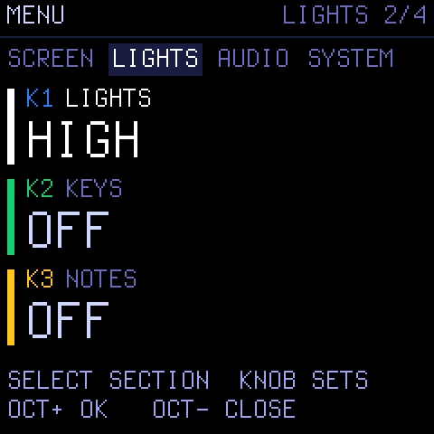 <i>The menu, LIGHTS section.</i>

**Hold HOME** on any screen. SELECT picks the section, the knobs set the values, `OCT+` opens an item, `OCT−` closes. PLAY still works. The menu closes back onto the screen you opened it from.

| Section | Items |
| --- | --- |
| SCREEN | COLOR (the palette), ZOOM |
| LIGHTS | LIGHTS: every button glows OFF / LOW / MID / HIGH, for the dark · KEYS: OFF, C KEYS, WHITE KEYS, ALL KEYS · NOTES: the notes playing light their keys |
| AUDIO | SPEAKER LOWCUT (for the built-in speaker) · USB AUDIO: follows MASTER, or FULL level · USB SERIAL (takes effect after a restart) |
| SYSTEM | HARDWARE CALIBRATION · 2ND CORE · ABOUT (version and credits) · LAST CRASH (report from the last crash, kept until power-off) |

If settings cannot be written, the screen says *SETTINGS NOT SAVED*.

### USB audio and MIDI

On USB the FM-1 is also an audio input for your computer or phone (no driver). MIDI clock, MIDI in and the sequencer to MIDI out are set on the GLO → SYSTEM page (MIDI, SYNC, IN, USB).

## 19 · Troubleshooting

| Problem | What to do |
| --- | --- |
| FM-1 won't start after an update | Hold OCT− while switching on (USB rescue) and install again from the companion app. |
| "EMPTY SECTION: REC" | The song has nothing recorded yet. Record a loop in STUDIO first. |
| "NO SONG: SAVE ONE FIRST" | There is no other song in the set. Save one in SONG → SET. |
| "NOT SAVED: AGAIN LOADS" | The song you have is edited and not saved. Press the same OCT again to load anyway, or save first. |
| "ON THE WAY: NEXT SONG" | A transition is playing; keys wait until it lands. |
| "READ ERROR" / "SAVE ERROR" | A flash read or write failed. The slot is not changed. Try again; back up your set. |
| Companion can't connect | Use Chrome, Edge or Firefox on a computer, or Chrome on Android. Safari and iOS have no Web MIDI. |
| Nothing changes when I press a section | It waits for Q (shown yellow). Set GLO to Q NOW for instant changes. |

Something else? Open **LAST CRASH** in the menu and include it when you report the bug.

## 20 · Glossary and abbreviations

| IN · BLD · DRP · ROL · BRK · DR2 · OUT | The sections: INTRO, BUILD, DROP, ROLL, BREAKDOWN, DROP 2, OUTRO. |
| --- | --- |
| AUTO / MAN | The song runs its chain by itself / the section loops until you choose. |
| Q | Quantise: when a change lands (NOW, BAR, 4 BARS). |
| Set | The four song slots LIVE plays through. |
| Card | A section's differences from its song (length, loop, style, bass, who plays). |
| FORM | The length of the whole song: SHORT 32, CLUB 64, LONG 128 bars. |
| VARIANT | Another arrangement (or phrase) from the same material. |
| MANGLE / ENERGY | How hard the BREAK generator cuts and rearranges. |
| Slice | One of the 8 pieces a break loop is cut into. |
| Pin | Fix a step's slice, or a chord, so the generator leaves it alone. |
| Under water | A track low-passed and 12 dB down. |
| LATCH | Make FX-panel tracks and effects stick without holding. |
| Pool | The shared memory for your own sounds (320 KB). |
| Yellow | Waiting for the boundary. |
| SCALE · QUANT · CHORD | Key and scale settings (SEL). |
| CMPLX · ANCHR · RETRIG | Complexity (how far the generator strays from the loop), anchor (how strongly slices stay tied to their place in the beat), stutter chance. |

### Credits

FMX is GPL-3.0-only, with full source, and comes with no warranty. Based on SLOOP by isod89 and Felucca by Leo Kuroshita, Hügelton Instruments; the BREAK generator after X0X by charlesvestal. Built-in breaks: OaSyntax's "Jungle Breaks" (Freesound, CC BY 3.0). Terminus font by Dimitar Toshkov Zhekov (SIL OFL 1.1). Full attributions are on the device's ABOUT page and in LICENSING.md.

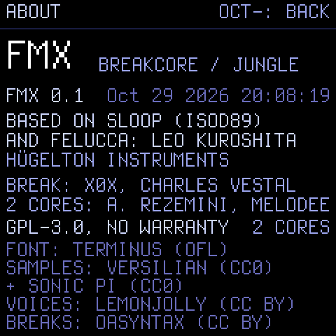 <i>ABOUT.</i>

