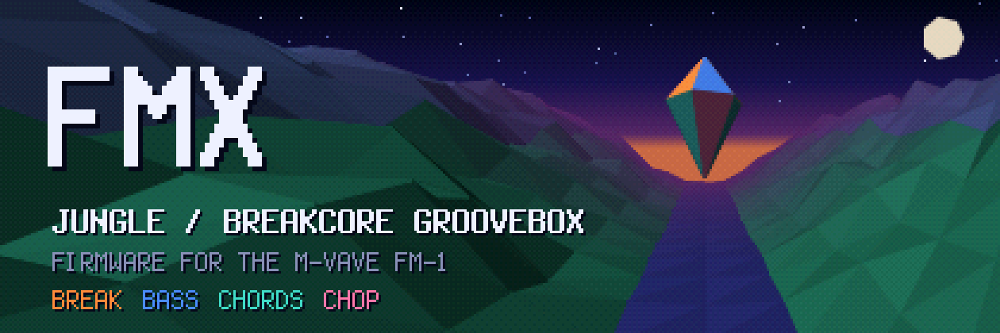
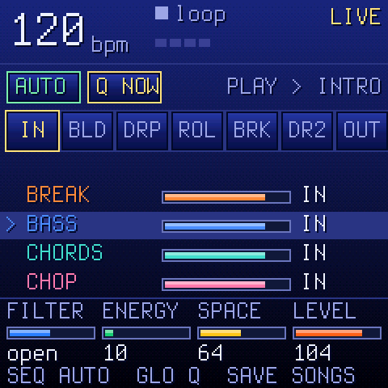
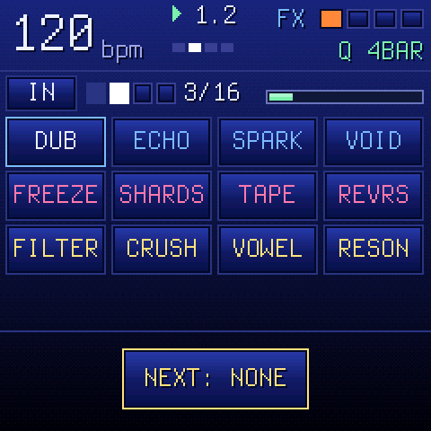
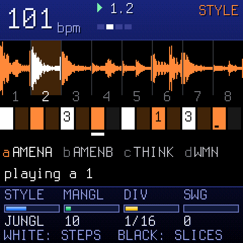
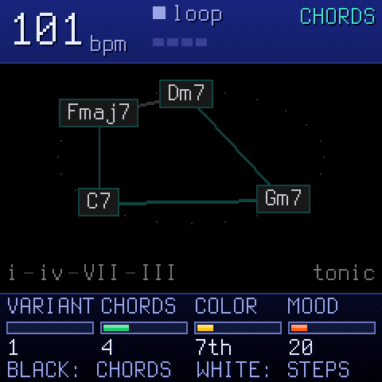

<b>A jungle / breakcore groovebox firmware for the M-VAVE FM-1.</b> 
Free and open source (GPL-3.0), based on <a href="https://github.com/isod89/sloop-fm1">SLOOP</a>, <a href="https://github.com/hugelton/Felucca">Felucca</a> and <a href="https://github.com/charlesvestal/fm1-x0x">X0X</a>.

<a href="https://ernestorebane.github.io/fmx/"><b>Install from the browser</b></a> ·
<a href="GUIDE.md"><b>User manual</b></a> (<a href="docs/FMX-Manual.pdf">PDF</a>) ·
<a href="BUILDING.md">Building</a> ·
<a href="LICENSING.md">Licensing</a> ·
<a href="../../issues">Report a bug</a>

---

FMX turns the FM-1 into a four-track jungle and breakcore machine you can plug into a PA and play a whole set on. Each track has its own generator, so the music writes itself while your hands shape it: you pick sections, mute and bring in tracks, throw effects, and move from song to song without stopping.

> **Status:** 1.0.0_beta. Install at your own risk, back up your set before you update, and please [report](../../issues) what you find. You can always go back to the stock firmware (see the manual, chapter 2).

## Screenshots

## The four tracks

| Track | What it does |
| --- | --- |
| **BREAK** | Chopped break loops (A–D), re-sequenced live by a generator, styles from STRAIGHT to CHAOS. Fourteen breaks built in. |
| **BASS** | Reese and sub basses playing a two-bar call-and-answer phrase tied to the break's kicks. |
| **CHORDS** | Pads, keys and organs over a generated chord progression; the bass can follow the root. |
| **CHOP** | A kit of 16 pads, a sliced loop (SLICE) played in time with the drums, or a lead playing a theme. |

## Two modes

- **LIVE** is for performing, with one fixed control map whatever track is in focus. White keys 1–7 pick the sections (INTRO, BUILD, DROP, ROLL, BREAKDOWN, DROP 2, OUTRO), 8 moves to the next song of the set, 9–12 mute tracks, and 13–16 are held moves (GAP, WASH, ROLL, REWIND). The knobs are FILTER, ENERGY, SPACE and LEVEL. Changes wait for the bar or the phrase (Q) so they always land in time. FMX boots into LIVE.
- **STUDIO** is for building songs: each track's own screen, its sound pages, recording, and the song's section cards.

Hold **FX** in either mode for the FX panel: 12 effects in three groups (SPACE, TIME, COLOUR: dub reverb, echo throws, freeze, tape stop, PSX crush…), aimed at any of the four tracks.

A set holds up to four songs. AUTO plays a song through its arrangement by itself, and moves into the next one with a BRIDGE, a SWAP or a CUT.

## Install

Open **[the FMX Companion](https://ernestorebane.github.io/fmx/)** and follow its **Firmware** section: connect the FM-1 by USB, press **Install FMX** and keep it on USB until it restarts and reports back. Connecting the FM-1 needs Web MIDI: Chrome, Edge or Firefox on a computer, or Chrome on Android.

The same page is everything off the device: it takes you back to the stock V15, manages your sounds, backs up your set, and runs the real FMX engine in the browser as an emulator, so you can try FMX before you install it. To build and serve it yourself, see [BUILDING.md](BUILDING.md).

If the FM-1 will not start, hold **OCT−** while you switch it on: it starts in USB rescue and you can install again.

## Building and tests

See [BUILDING.md](BUILDING.md): the JieLi toolchain and three files of the AC79 SDK, then `./build.sh`. `sh tools/check.sh` runs the whole check in one command: the target build, the host test suite (audio renders, CPU budgets, sequencer timing, UI, storage, the update loader), the WebAssembly emulator and the companion site.

## Contributing

- **Bugs and ideas:** [open an issue](../../issues): what you did, what you expected, what happened, and the version from HOME (hold) → ABOUT.
- **Pull requests** are welcome. Keep the style of the code around your change, add a host test when you can, and make sure `sh tools/check.sh` passes.
- By contributing you agree that your code is released under GPL-3.0, like the rest of FMX.

## Credits

- **[SLOOP](https://github.com/isod89/sloop-fm1)** by isod89, the live groovebox firmware for the FM-1 that FMX is forked from.
- **[Felucca](https://github.com/hugelton/Felucca)** by **Leo Kuroshita** (@kurogedelic) / **Hügelton Instruments**: the engines, the sequencer and the update path SLOOP and FMX build on.
- **[X0X](https://github.com/charlesvestal/fm1-x0x)** by charlesvestal: the BREAK generator follows its break engine.
- Built-in breaks: OaSyntax's "Jungle Breaks" pack on Freesound (CC BY 3.0). Samples: Versilian Studios VSCO-2 CE and VCSL, Sonic Pi (CC0). Font: Terminus by Dimitar Toshkov Zhekov (SIL OFL 1.1). Full list in [LICENSING.md](LICENSING.md) and on the device's ABOUT page.

## Support

FMX is free and stays free. If it gives you a good set and you want to say thanks, you can buy me a coffee on **[Ko-fi](https://ko-fi.com/ernestorebane)**. It is a voluntary tip: nothing in FMX is locked behind it, and it goes to FMX's author, not to M-VAVE.

## Licence

Code: GPL-3.0-only (see [LICENSE](LICENSE), and [LICENSING.md](LICENSING.md) for the assets). No warranty. M-VAVE and FM-1 are trademarks of their owners; FMX is not affiliated with or endorsed by them.
